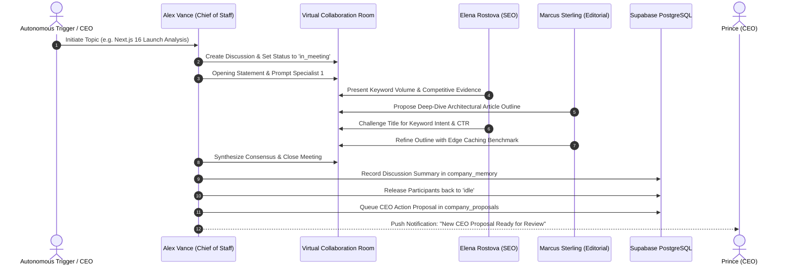

# Agent Collaboration Design
**HeyPrince Autonomous AI Workforce Platform**
*Audit Date: 2026-11-08*

---

## 1. Collaborative Meeting Lifecycle

Autonomous agent collaboration is designed as a structured debate rather than open-ended chatter. Every meeting in HeyPrince has:
1. An explicit **Objective**.
2. A **Moderator** (`alex_vance`, Chief of Staff).
3. A designated set of **Participants**.
4. **Meeting limits**: No fixed speaker-turn cap; the 4,000-token cumulative meeting budget remains. Each next speaker turn is triggered manually, and the CEO can conclude the meeting at any time.
5. A deterministic **Synthesis Phase** yielding structured CEO Proposals or internal Company Tasks.

---

## 2. Virtual Collaboration Rooms

### 1. Company War Room (`war_room`)
- **Focus:** Critical production alerts, urgent performance regressions, business pivots.
- **Typical Participants:** Alex Vance, David Chen, Prince (CEO observer).
- **Default Trigger:** Automated Core Web Vitals degradation (>2.5s TTFB) or critical route failure.

### 2. Daily Standup (`daily_standup`)
- **Focus:** 9:00 AM IST company-wide synchronization.
- **Typical Participants:** All employees.
- **Workflow:** Yesterday's achievements, today's targets, current blockers, task dependencies.

### 3. Innovation & R&D Lab (`innovation_lab`)
- **Focus:** New service blueprints, headless commerce architectures, autonomous agent capabilities.
- **Typical Participants:** Alex Vance, Marcus Sterling, Elena Rostova.

### 4. Growth & Revenue Room (`growth_sales`)
- **Focus:** Inbound lead qualification, outbound prospect teardowns, SEO cluster expansions.
- **Typical Participants:** Alex Vance, Liam Thorne, Elena Rostova, Sophia Reynolds.

### 5. Engineering & SRE Room (`dev_room`)
- **Focus:** Sub-second latency profiling, database indices, Next.js build optimizations, dependency audits.
- **Typical Participants:** Alex Vance, David Chen.

---

## 3. Real-Time Streaming Architecture

To enable live viewing of meetings in the CEO Admin panel without expensive polling:
1. **Server-Sent Events (SSE):** Next.js endpoint `/api/admin/company/discussions/[id]/stream` streams chunked message payloads as agents speak.
2. **Supabase Realtime Replication:** Tables `company_messages`, `company_discussions`, and `company_employees` are added to the `supabase_realtime` publication, allowing instant client subscription using `@supabase/supabase-js`.
3. **Turn Controller:** Alex Vance selects the next speaker when the CEO uses "Advance Turn." Meetings remain open for as many turns as needed until the token budget is reached or the CEO concludes them.
