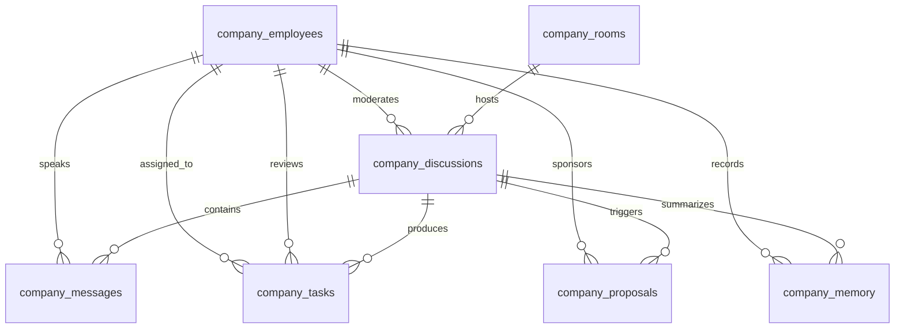

# AI Company Database Design
**HeyPrince Autonomous AI Workforce Platform**
*Audit Date: 2026-11-08*

---

## 1. Schema Overview

The database design provides a unified, relational backbone for autonomous employee identities, virtual rooms, turn-by-turn meeting transcripts, hierarchical tasks, CEO action proposals, and multi-tier corporate memory.

The schema lives in `src/lib/company/schema.sql` and is verified in Supabase PostgreSQL.

---

## 2. Entity Relationship Diagram

---

## 3. Data Dictionary

### 1. `company_employees`
| Column | Type | Constraints | Description |
| :--- | :--- | :--- | :--- |
| `id` | `TEXT` | `PRIMARY KEY` | Unique slug (e.g., `alex_vance`, `elena_rostova`) |
| `legacy_agent_id`| `TEXT` | `REFERENCES chief_agents(id)` | Legacy mapping for backward compatibility |
| `name` | `TEXT` | `NOT NULL` | Full humanoid name |
| `display_title` | `TEXT` | `NOT NULL` | Corporate title (e.g., Head of Search) |
| `department` | `TEXT` | `CHECK IN ('Executive', 'Growth', 'Editorial', 'Infrastructure', 'Sales', 'Product', 'Analytics', 'Client Solutions')` | Department assignment |
| `avatar_url` | `TEXT` | `NOT NULL` | Path to avatar image (`/assets/avatars/...`) |
| `bio` | `TEXT` | `NOT NULL` | Professional background and philosophy |
| `personality_archetype`| `TEXT`| `NOT NULL` | Psychological profile (e.g., ENTJ, INTJ) |
| `system_prompt_overlay`| `TEXT`| `NOT NULL` | In-character behavioral prompt instructions |
| `model_preference`| `TEXT` | `DEFAULT 'gemini-3.5-flash'` | Routing model target |
| `status` | `TEXT` | `CHECK IN ('idle', 'thinking', 'researching', 'in_meeting', 'working', 'waiting_for_approval', 'blocked', 'reviewing', 'offline')` | Real-time live status |
| `current_activity` | `TEXT` | `NULLABLE` | Short description of current action |
| `tool_permissions` | `JSONB` | `DEFAULT '{}'` | Array of allowed tools and approval constraints |
| `performance_metrics`| `JSONB` | `DEFAULT '{}'` | Tasks completed, token usage, proposals score |
| `created_at` / `updated_at` | `TIMESTAMPTZ` | `DEFAULT NOW()` | Timestamps |

### 2. `company_rooms`
| Column | Type | Constraints | Description |
| :--- | :--- | :--- | :--- |
| `id` | `TEXT` | `PRIMARY KEY` | Room identifier (`war_room`, `daily_standup`, etc.) |
| `name` | `TEXT` | `NOT NULL` | Human-readable room title |
| `room_type` | `TEXT` | `CHECK IN ('war_room', 'daily_standup', 'innovation_lab', 'growth_sales', 'dev_room')` | Category of collaborative meetings |
| `description` | `TEXT` | `NOT NULL` | Room mandate and focus |
| `icon_name` | `TEXT` | `DEFAULT 'MessageSquare'` | Lucide icon identifier for UI rendering |
| `max_participants` | `INTEGER` | `DEFAULT 8` | Capacity limit |

### 3. `company_discussions`
| Column | Type | Constraints | Description |
| :--- | :--- | :--- | :--- |
| `id` | `UUID` | `PRIMARY KEY DEFAULT gen_random_uuid()` | Unique discussion identifier |
| `room_id` | `TEXT` | `REFERENCES company_rooms(id)` | Virtual room location |
| `title` | `TEXT` | `NOT NULL` | Agenda title |
| `objective` | `TEXT` | `NOT NULL` | Explicit goal / completion criteria |
| `moderator_id` | `TEXT` | `REFERENCES company_employees(id)` | Meeting facilitator (defaults to `alex_vance`) |
| `participant_ids` | `TEXT[]` | `NOT NULL` | Array of attending employee IDs |
| `status` | `TEXT` | `CHECK IN ('in_progress', 'concluded', 'converted_to_task', 'cancelled')` | Meeting state |
| `token_budget` | `INTEGER` | `DEFAULT 4000` | Hard cap on token consumption |
| `tokens_consumed` | `INTEGER` | `DEFAULT 0` | Cumulative tokens used |
| `turn_count` | `INTEGER` | `DEFAULT 0` | Current speaker turns elapsed |
| `max_turns` | `INTEGER` | `DEFAULT 8` | Maximum allowable turns before forced conclusion |
| `conclusion` | `JSONB` | `NULLABLE` | Final synthesis, consensus, and action items |
| `created_at` / `concluded_at` | `TIMESTAMPTZ` | | Lifecycle timestamps |

### 4. `company_messages`
| Column | Type | Constraints | Description |
| :--- | :--- | :--- | :--- |
| `id` | `BIGSERIAL` | `PRIMARY KEY` | Incremental message sequence |
| `discussion_id` | `UUID` | `REFERENCES company_discussions(id)` | Parent discussion |
| `sender_id` | `TEXT` | `REFERENCES company_employees(id)` | Speaking agent |
| `message_type` | `TEXT` | `CHECK IN ('statement', 'proposal', 'challenge', 'evidence', 'consensus', 'dissent', 'summary')` | Conversational role |
| `content` | `TEXT` | `NOT NULL` | The message text (strictly no em dashes) |
| `evidence` | `JSONB` | `DEFAULT '{}'` | Structured data citations, URLs, code snippets |
| `tokens_used` | `INTEGER` | `DEFAULT 0` | Token cost of this message |
| `created_at` | `TIMESTAMPTZ` | `DEFAULT NOW()` | Message timestamp |

### 5. `company_tasks`
| Column | Type | Constraints | Description |
| :--- | :--- | :--- | :--- |
| `id` | `UUID` | `PRIMARY KEY DEFAULT gen_random_uuid()` | Task ID |
| `discussion_id` | `UUID` | `REFERENCES company_discussions(id)` | Originating meeting |
| `proposal_id` | `UUID` | `NULLABLE` | Approved CEO proposal if required |
| `assigned_to` | `TEXT` | `REFERENCES company_employees(id)` | Responsible employee |
| `assigned_by` | `TEXT` | `REFERENCES company_employees(id)` | Assigning agent (e.g., Alex Vance) |
| `reviewer_id` | `TEXT` | `REFERENCES company_employees(id)` | Independent verification agent |
| `title` | `TEXT` | `NOT NULL` | Actionable title |
| `description` | `TEXT` | `NOT NULL` | Scope and execution steps |
| `acceptance_criteria` | `TEXT[]` | `NOT NULL` | Measurable definition of done |
| `status` | `TEXT` | `CHECK IN ('pending', 'in_progress', 'review_ready', 'completed', 'blocked', 'failed')` | Task workflow status |
| `priority` | `TEXT` | `CHECK IN ('low', 'medium', 'high', 'urgent')` | Priority level |
| `depends_on_task_ids` | `UUID[]`| `DEFAULT '{}'` | Prerequisites |
| `execution_payload` | `JSONB` | `DEFAULT '{}'` | Input parameters |
| `output_result` | `JSONB` | `DEFAULT '{}'` | Output evidence / deliverables |
| `verification_notes` | `TEXT` | `NULLABLE` | Reviewer notes before completion |
| `due_date` | `TIMESTAMPTZ` | `NULLABLE` | Target completion time |

### 6. `company_proposals`
| Column | Type | Constraints | Description |
| :--- | :--- | :--- | :--- |
| `id` | `UUID` | `PRIMARY KEY DEFAULT gen_random_uuid()` | Proposal ID |
| `discussion_id` | `UUID` | `REFERENCES company_discussions(id)` | Source discussion |
| `sponsored_by` | `TEXT` | `REFERENCES company_employees(id)` | Sponsoring agent |
| `title` | `TEXT` | `NOT NULL` | Action proposal title |
| `proposal_type` | `TEXT` | `CHECK IN ('publish_content', 'outreach_campaign', 'site_modification', 'new_agent_activation', 'financial_expense')` | Category requiring CEO approval |
| `business_justification` | `TEXT` | `NOT NULL` | Expected ROI and strategic fit |
| `action_payload` | `JSONB` | `DEFAULT '{}'` | Exact parameters to execute once approved |
| `estimated_cost_usd` | `NUMERIC(10,4)` | `DEFAULT 0.0000` | Estimated external cost |
| `status` | `TEXT` | `CHECK IN ('pending_approval', 'approved', 'rejected', 'changes_requested', 'expired')` | Approval status |
| `ceo_feedback` | `TEXT` | `NULLABLE` | Comments from Prince (CEO) |
| `approved_at` / `executed_at` | `TIMESTAMPTZ` | | Lifecycle timestamps |
| `expires_at` | `TIMESTAMPTZ` | `DEFAULT NOW() + 7 days` | Automatic expiration |

### 7. `company_memory`
| Column | Type | Constraints | Description |
| :--- | :--- | :--- | :--- |
| `id` | `UUID` | `PRIMARY KEY DEFAULT gen_random_uuid()` | Memory entry ID |
| `scope` | `TEXT` | `CHECK IN ('company', 'department', 'employee', 'meeting')` | Isolation tier |
| `department` | `TEXT` | `NULLABLE` | Department tag |
| `employee_id` | `TEXT` | `REFERENCES company_employees(id)` | Owning agent |
| `discussion_id` | `UUID` | `REFERENCES company_discussions(id)` | Sourced discussion |
| `category` | `TEXT` | `CHECK IN ('strategy', 'decision', 'learning', 'performance_benchmark', 'market_intelligence', 'failed_experiment')` | Memory type |
| `insight` | `TEXT` | `NOT NULL` | Core takeaway or knowledge statement |
| `metadata` | `JSONB` | `DEFAULT '{}'` | Associated structured data |
| `confidence_score` | `NUMERIC(3,2)` | `DEFAULT 1.00` | Confidence weighting |
