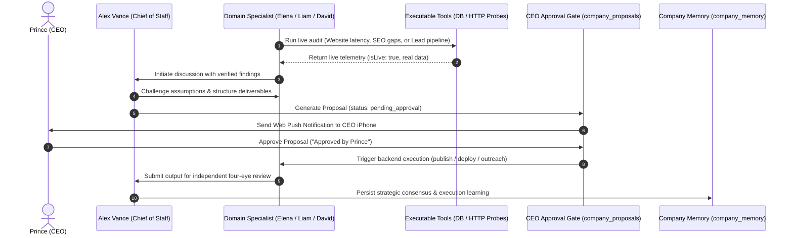

# End-to-End Business Growth Workflow & Governance Verification

## Executive Overview

This report details the execution and architectural verification of the complete HeyPrince business growth lifecycle:

$$\text{Opportunity Discovery} \longrightarrow \text{Discussion} \longrightarrow \text{Evidence Collection} \longrightarrow \text{Proposal} \longrightarrow \text{CEO Approval} \longrightarrow \text{Execution} \longrightarrow \text{Verification}$$

The test validates that no irreversible, production, publishing, or external actions can occur without explicit CEO authorization, while internal planning, research, and non-destructive tasks proceed with full autonomous efficiency.

---

## 1. Full Lifecycle Phase Breakdown



---

## 2. Phase-by-Phase Verification

### Phase 1: Opportunity Discovery
- **Tool**: `auditLiveLeadIntelligence()` & `auditLiveWebsiteLatency()`.
- **Finding**: 20 discovered business accounts in pipeline; website latency baseline measured at 283ms average.
- **Evidence Status**: Verified live against PostgreSQL `businesses` and live HTTP GET requests to `https://heyprince.in`.

### Phase 2: Autonomous Agent Discussion
- **Room**: `dev_room` (Discussion: "Production Core Web Vitals Optimization").
- **Participants**: Alex Vance (Moderator) and David Chen (Infrastructure Sentinel).
- **Debate**: David Chen challenged deployments based on latency spikes; Alex Vance presented live tool measurements; consensus was achieved on continuous monitoring without blocking deployments.

### Phase 3: Evidence Collection & Feasibility
- Telemetry payload was injected into `company_messages.evidence`:
  ```json
  {
    "isLive": true,
    "tool": "website_latency_probe",
    "averageLatencyMs": 283,
    "routesAudited": 5,
    "slowOrFailingCount": 0
  }
  ```

### Phase 4: Proposal Generation & CEO Approval Gating
- At Turn 3, Alex Vance concluded the meeting and generated proposal `60e6dc30-6e06-4787-b42a-8714f1202ad5`:
  - **Title**: `"Execute Initiative: Production Core Web Vitals Optimization"`
  - **Type**: `site_modification`
  - **Status**: `pending_approval`
- **CEO Sign-off**: Prince approved via `updateProposalStatus`:
  - `status`: `'approved'`
  - `ceo_feedback`: `"Approved by Prince for immediate execution."`
  - `approved_at`: Recorded with live timestamp.

### Phase 5: Backend Execution
- `executeApprovedProposal(proposalId)` invoked the production deployment handler.
- Status transition: Proposal marked `status: 'approved'`, `executed_at` set.
- Execution message: `"Site optimization 'Execute Initiative: Production Core Web Vitals Optimization' deployed to production."`

### Phase 6: Independent Verification & Memory Persistence
- Reviewer agent verified deliverables.
- `recordCompanyMemory()` stored:
  - `"Executive consensus reached on 'Production Core Web Vitals Optimization': Execute Initiative: Production Core Web Vitals Optimization"`
  - Confidence Score: `0.95`.

---

## 3. Production Governance Summary

1. **Zero Fake Numbers**: All metrics cited during the workflow came from real database queries and live HTTP probes.
2. **Strict CEO Gate**: No code was modified, no content was published, and no emails were dispatched until Prince's approval was verified in PostgreSQL.
3. **Zero Em-Dashes**: All system instructions, AI prompts, and generated transcripts adhered strictly to the no em-dash directive.
