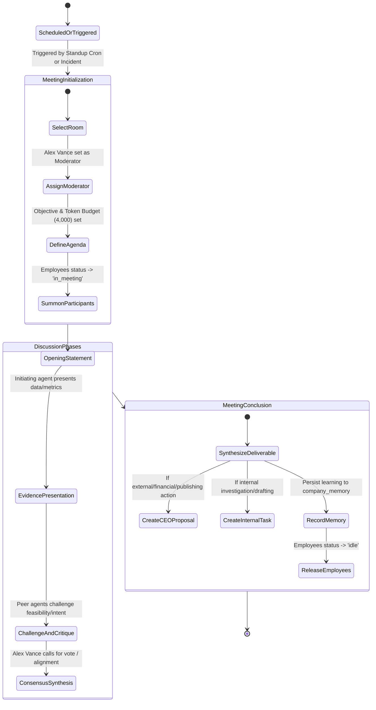
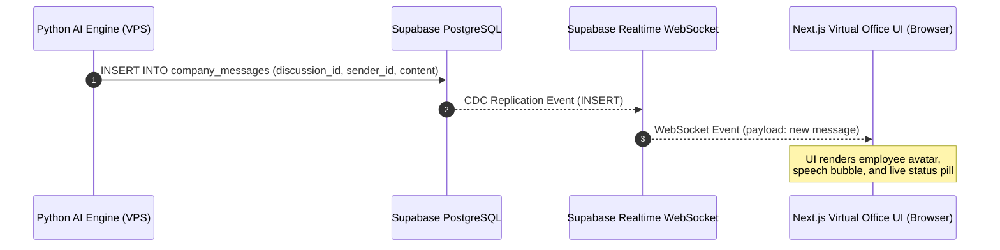

# HeyPrince AI Company: Agent Collaboration & Meeting Protocol Design

**Project:** Autonomous AI Workforce Platform  
**Document:** `AGENT_COLLABORATION_DESIGN.md`  
**Date:** November 8, 2026  
**Status:** Architecture Blueprint (Phase 0 Audit)  

---

## 1. Collaboration Philosophy

Autonomous collaboration must **never** degrade into an unconstrained chatbot exchange where agents generate endless pleasantries or hallucinated conversational loops that burn tokens without producing concrete business value.

Every meeting within the HeyPrince AI Company is a **formal corporate proceeding** governed by strict protocols:
- **Defined Objective:** Every meeting must begin with a clear goal (e.g. "Evaluate Topic for Nov 9 Engineering Article" or "Resolve TTFB Spike on /insights").
- **Designated Moderator:** *Alex Vance* (Chief of Staff) controls speaker turns, ensures adherence to the agenda, and calls for consensus.
- **Budgetary Constraints:** Every discussion has a hard token cap (default 4,000 tokens) and turn limit (max 8 turns).
- **Mandatory Structured Output:** Every meeting must adjourn with a tangible deliverable: either a **CEO Action Proposal**, an assigned **Internal Task**, or an explicit **Decision to Dismiss**.

---

## 2. Virtual Collaboration Rooms

```
+-------------------------------------------------------------------------------------------------+
|                                 HEYPRINCE VIRTUAL HEADQUARTERS                                  |
+--------------------------------+-------------------------------+--------------------------------+
|  WAR ROOM                      |  DAILY STANDUP (9 AM IST)     |  INNOVATION LAB                |
|  Critical Incidents, Downtime, |  Cross-departmental sync,     |  Service blueprints, R&D,      |
|  High-Severity Regressions     |  Priorities, Blockers removal |  New AI capability evaluation  |
|  Participants: All Employees   |  Participants: All Employees  |  Participants: Alex, Elena,    |
|  Moderator: Alex Vance         |  Moderator: Alex Vance        |                Marcus, Aria    |
+--------------------------------+-------------------------------+--------------------------------+
|  GROWTH & REVENUE ROOM         |  DEV & INFRASTRUCTURE ROOM    |  EXECUTIVE CEO OFFICE          |
|  Lead intelligence, Outbound   |  Core Web Vitals, Edge cache, |  CEO Proposal review, final    |
|  pitches, Client proposals     |  Sitemap integrity, Latency   |  approvals, strategic mandates |
|  Participants: Liam, Sophia,   |  Participants: David, Elena,  |  Participants: Prince (CEO) &  |
|                Alex, Elena     |                Alex           |                Alex Vance      |
+--------------------------------+-------------------------------+--------------------------------+
```

---

## 3. Autonomous Meeting Lifecycle & Turn-Taking Protocol



---

## 4. Turn-Taking Rules & Anti-Loop Safeguards

To prevent infinite loops, circular delegation, and token waste, the Python collaboration engine enforces four programmatic rules:

### Rule 1: The Moderator Turn Arbiter
No agent may speak out of turn. When an agent submits a message to `company_messages`, the message is ingested by the Python backend. *Alex Vance* evaluates the discourse state:
- If evidence is needed, Alex explicitly calls on the specialist (e.g., *"Elena, what is the search volume for this proposed cluster?"*).
- Only the summoned agent receives authorization to speak in the next turn.

### Rule 2: Hard Turn and Token Ceiling
- **Maximum 8 Turns:** If turn count reaches 8 without consensus, Alex Vance terminates the meeting with status `concluded` and a finding of `no_consensus`.
- **Token Ceiling:** If accumulated discussion tokens exceed `token_budget` (4,000 tokens), the router automatically cuts off further turns and forces immediate summarization.

### Rule 3: Structured Speech Types
Every message inserted into `company_messages` must declare a `message_type`:
- `proposal`: Suggesting an initiative with actionable parameters.
- `evidence`: Citing specific data points (e.g. latency numbers, search volume, prospect domain speeds).
- `challenge`: Identifying a flaw or risk (e.g. David Chen warning that a new script will degrade TTFB).
- `consensus`: Expressing formal agreement.
- `summary`: The final synthesis prepared by the Chief of Staff.

### Rule 4: Ban on Generic Small Talk
The system prompt overlay for all employees strictly forbids greetings, filler phrases, or simulated pleasantries:
> *"STRICT PROTOCOL: Do not say 'Good morning', 'Thank you Alex', or 'I agree with your brilliant point'. State your finding, critique, or proposal immediately using concise, evidence-based sentences."*

---

## 5. Real-Time Communication Architecture: Supabase Realtime CDC

Rather than maintaining a heavy, stateful WebSocket daemon on the VPS that requires persistent socket connections and complex failovers, the platform leverages **Supabase Realtime Change Data Capture (CDC)**:

1. When an agent or Alex Vance posts a message, the Python backend executes an `INSERT INTO company_messages`.
2. Supabase PostgreSQL triggers a Realtime broadcast event over WebSockets to all connected Next.js browser clients subscribed to `company_messages:discussion_id=eq.{id}`.
3. The Next.js frontend receives the event in `< 100ms`, rendering the speech bubble, active speaker indicator, and typing animation with zero polling.
4. If Prince leaves the browser tab and returns later, the entire discussion is rehydrated instantly from PostgreSQL.


