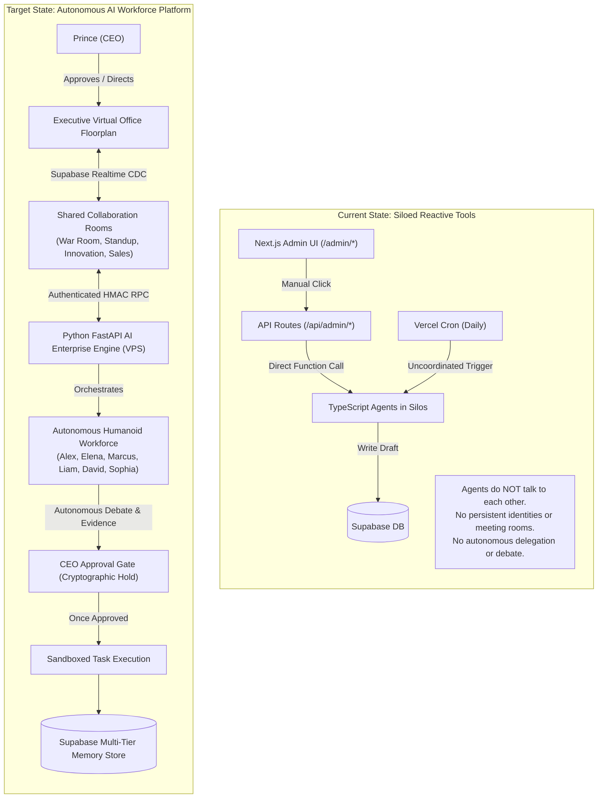

# HeyPrince AI Company: Current Architecture & Baseline Audit

**Project:** Autonomous AI Workforce Platform  
**Document:** `AI_COMPANY_CURRENT_ARCHITECTURE.md`  
**Date:** November 8, 2026  
**Status:** Architecture Blueprint (Phase 0 Audit)  

---

## 1. Executive Overview

The vision of the **HeyPrince AI Company** is to transform `heyprince.in` from a traditional personal portfolio and passive blog into a **living, 24/7 Autonomous AI Enterprise**. In this organization:
- **Prince (Owner)** is the **Chief Executive Officer (CEO)** holding absolute approval authority over all production, external, and financial actions.
- **Autonomous AI Employees** operate continuously in a shared virtual corporate environment. They independently monitor markets, inspect infrastructure, hold cross-functional meetings, plan initiatives, delegate subtasks, and present actionable proposals to the CEO.
- The company features distinct **humanoid employee identities** with realistic names, avatars, departments, personality archetypes, and specialized skills.

This document establishes the verified baseline of what already exists in the codebase today versus what must be built to realize this autonomous enterprise.

---

## 2. Current Architecture vs. Autonomous Company Target

---

## 3. Verified Repository Inventory (What Exists in Code Today)

The following capabilities have been verified by inspecting code and testing execution:

| Architecture Layer | Current Code Location | Verified Status | Reusability for AI Company |
| :--- | :--- | :---: | :--- |
| **Next.js 16 Frontend** | `src/app/`, `src/components/` | 🟢 Active | Host for the Humanoid Virtual Office, Realtime Meeting Room, and CEO Approval Center. |
| **Admin Portal UI** | `src/app/(payload)/admin/*` | 🟢 Active | Already contains navigation, dark theme styling, and layouts for Chief of Staff, News, and Leads. |
| **Python FastAPI Backend** | `heyprince-ai-backend/` | 🟡 88% Complete | Clean containerized service. Hosts the asynchronous agent loops, debate engine, and LLM routers. |
| **M2M Security** | `src/lib/ai-backend-client.ts` & `app/core/security.py` | 🟢 Tested & Verified | Cryptographic HMAC-SHA256 authenticated RPC with 300s timestamp replay defense. |
| **Cloud Model Router** | `src/lib/daily-news/ai-provider.ts` & `app/llm/` | 🟢 Tested & Verified | Gemini 3.5 Flash live inference verified (under 3.5s response). Em-dash sanitization verified. |
| **Local Model Router** | `app/llm/ollama_client.py` | 🟢 Implemented | Gracefully detects local host online/offline state. Ready for CPU or private GPU inference. |
| **Visual Synthesizer** | `app/pipeline/image_generator.py` | 🟢 Tested & Verified | Pollinations AI visual generation verified (7.37s response time for 8K resolution images). |
| **Database Layer** | Supabase PostgreSQL (`src/lib/chief-of-staff/schema.sql`) | 🟢 Seeded & Operational | Contains foundational `chief_agents`, `chief_tasks`, `chief_content_drafts`, `chief_activity_logs`. |
| **External Integrations** | LinkedIn OAuth, Resend, OpenStreetMap | 🟢 Active | Production tools ready to be bound to specific agent permission tiers. |

---

## 4. Gap Analysis: What is Missing for the AI Company

To transition from uncoordinated tools to an Autonomous Workforce, the following 6 structural gaps must be engineered:

### Gap 1: Absence of Multi-Agent Collaboration & Meeting Rooms
- **Current State:** Agents execute in total isolation. `seo_growth` does not know what `content_researcher` is writing; `website_guardian` discovers a performance drop but cannot summon `seo_growth` to discuss the impact.
- **Required Solution:** Introduce virtual collaboration rooms (`company_rooms`) and structured meeting protocols where agents speak, challenge evidence, debate trade-offs, and reach consensus.

### Gap 2: Lack of Humanoid Personas & Permanent Identity
- **Current State:** Agents are represented as anonymous string IDs (`"content_researcher"`, `"website_guardian"`).
- **Required Solution:** Implement full employee identities with humanoid avatars, names, titles, departments, personality profiles, and distinct voices (e.g. *Elena Rostova* as Head of Search; *David Chen* as Lead Site Reliability Engineer).

### Gap 3: Uncoordinated Duplicate Schedulers
- **Current State:** Vercel Edge Crons and Python APScheduler run independently, risking duplicate execution and double draft generation.
- **Required Solution:** Unify scheduling under the Chief of Staff (*Alex Vance*), who orchestrates the daily 9:00 AM IST company standup and delegates work on demand.

### Gap 4: Missing Stateful Task Dependency Engine
- **Current State:** `chief_tasks` records individual executions with no concept of task dependencies (`task B depends on task A completing successfully`).
- **Required Solution:** Upgrade task schema to support directed acyclic task graphs (DAGs), peer verification, and automated delegation.

### Gap 5: Frontend Lacks Virtual Office Visualization
- **Current State:** The admin dashboard displays traditional tabular grids and static cards.
- **Required Solution:** Create an engaging, lightweight 2.5D virtual office floorplan and real-time meeting room interface powered by Supabase Realtime CDC.

### Gap 6: Absence of Multi-Tier Memory Store
- **Current State:** Agent memory is limited to raw log rows in `chief_activity_logs`.
- **Required Solution:** Separate company knowledge into:
  1. **Company-Wide Memory** (Strategic OKRs, brand guidelines, approved decisions).
  2. **Department Memory** (SEO data, lead criteria, uptime benchmarks).
  3. **Agent Episodic Memory** (Past successful and failed initiatives).
  4. **Ephemeral Meeting Context** (Active conversational scratchpad).

---

## 5. Architectural Invariants (Strict Preservation Rules)

1. **Next.js Remains the Public Web & Application Front Door:**  
   Public visitors, SEO bots, portfolio pages, and admin authentication remain 100% on Next.js 16 hosted on Vercel.
2. **Python FastAPI Handles Long-Running & Heavy Compute:**  
   Multi-agent debate rounds, deep research loops, and token-heavy LLM synthesis run exclusively in Python on the VPS, avoiding serverless timeout crashes.
3. **Supabase PostgreSQL is the Single Source of Truth:**  
   Both Next.js and Python read and write to the same Supabase database. No separate unmanaged databases will be introduced.
4. **Zero Bypassing of CEO Authority:**  
   All outbound, external, financial, and code modifications strictly require explicit approval from Prince before execution.
