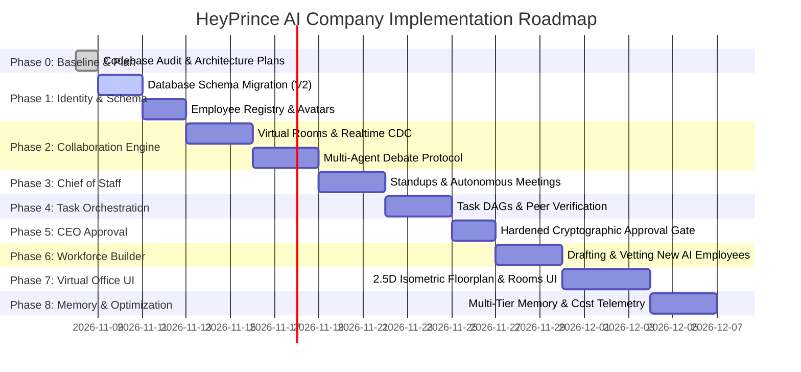

# HeyPrince AI Company: Phased Implementation Roadmap

**Project:** Autonomous AI Workforce Platform  
**Document:** `AI_WORKFORCE_IMPLEMENTATION_ROADMAP.md`  
**Date:** November 8, 2026  
**Status:** Architecture Blueprint (Phase 0 Audit)  

---

## 1. Phasing Strategy

The transformation into an Autonomous AI Company will proceed in **8 disciplined, non-destructive phases**. Each phase is self-contained, fully testable, and strictly preserves existing website and admin functionality.

---

## 2. Detailed Milestone Breakdown

### Phase 1: Employee Registry & Schema Migration (Days 1–2)
- **Objective:** Deploy safe SQL migration `V2_ai_company_schema.sql` to Supabase PostgreSQL and seed all 6 core humanoid employees.
- **Deliverables:**
  - `company_employees`, `company_rooms`, `company_discussions`, `company_messages`, `company_tasks`, `company_proposals`, `company_memory` tables created.
  - Supabase Realtime replication enabled on collaboration tables.
  - Next.js TypeScript types in `src/lib/company/types.ts`.
- **Testing:** Verify zero table collisions and confirm initial 6 employees query cleanly.

### Phase 2: Collaboration Rooms & Real-Time Messaging (Days 3–5)
- **Objective:** Build the Python collaborative discourse loop and Next.js Realtime message stream.
- **Deliverables:**
  - Python router in `heyprince-ai-backend/app/company/discussions.py`.
  - Next.js client hook `useCompanyRoom(roomId)` utilizing Supabase Realtime WebSocket subscriptions.
  - Turn-taking moderation engine enforcing token budgets and maximum 8 speaker turns.
- **Testing:** Execute simulated War Room debate between *Elena Rostova* and *David Chen*; verify message delivery in `< 100ms`.

### Phase 3: Chief of Staff Autonomous Standups (Days 6–8)
- **Objective:** Empower *Alex Vance* to autonomously conduct the Daily 9:00 AM Standup.
- **Deliverables:**
  - Python scheduled worker executing standup sequence: status collection -> blocker review -> agenda prioritization -> summary generation.
  - Auto-generation of Daily Briefing for Prince.
- **Testing:** Trigger manual standup via API; verify structured output and employee status transitions.

### Phase 4: Collaborative Task Orchestration (Days 9–11)
- **Objective:** Implement the stateful task engine with peer verification.
- **Deliverables:**
  - `company_tasks` state machine in Python and Next.js.
  - Peer review assignment (e.g. *David Chen* automatically assigned as reviewer for *Marcus Sterling's* blog publishing task).
  - Dependency checking (Task B waits for Task A).
- **Testing:** Create multi-stage task pipeline; verify that failure of Task A cleanly halts Task B.

### Phase 5: Hardened CEO Sovereign Approval Gate (Days 12–13)
- **Objective:** Enforce cryptographic, backend-validated approval holds for all production, publishing, and external actions.
- **Deliverables:**
  - Next.js approval API `/api/admin/company/proposals/approve` generating 15-minute signed HMAC execution tokens.
  - Python execution worker verifying token signature and payload hash before tool execution.
  - Revamped `/admin/ai-approvals` UI with side-by-side asset preview.
- **Testing:** Attempt to execute a publishing tool directly from Python without CEO approval; verify immediate 403 Forbidden rejection.

### Phase 6: AI Workforce Builder (Days 14–16)
- **Objective:** Allow existing employees to draft proposals for hiring new specialized AI employees.
- **Deliverables:**
  - Candidate vetting workflow: capability gap analysis -> prompt formulation -> tool restriction definition -> draft creation.
  - CEO review card with one-click "Hire & Activate" button.
  - Safeguard preventing recursive agent self-replication.
- **Testing:** Marcus and Alex recommend *Aria Nakamura* (Product Strategist); verify draft creation in `company_employees` with status `draft`.

### Phase 7: Humanoid Virtual Office UI (Days 17–20)
- **Objective:** Launch the 2.5D Isometric Virtual Office floorplan and interactive meeting room in Next.js.
- **Deliverables:**
  - `/admin/company/office` interactive floorplan with GSAP micro-animations and status glows.
  - `/admin/company/rooms/[roomId]` live meeting dialogue theater.
  - Mobile-responsive navigation.
- **Testing:** Cross-browser testing on Chrome, Safari iOS, and Firefox; verify 60 FPS performance and zero layout shift.

### Phase 8: Multi-Tier Memory & Cost Telemetry (Days 21–23)
- **Objective:** Implement long-term corporate memory and real-time inference cost analytics.
- **Deliverables:**
  - Multi-tier memory retrieval (`company`, `department`, `employee`, `meeting`).
  - Negative feedback weighting so rejected ideas are permanently remembered.
  - Token and financial telemetry dashboard tracking monthly Gemini API spend.
- **Testing:** Inject a rejected proposal; verify that subsequent meeting brainstorming explicitly discounts that direction.

---

## 3. Risk Mitigation Matrix

| Potential Risk | Severity | Mitigation Strategy |
| :--- | :---: | :--- |
| **Token Cost Runaway in Multi-Agent Debates** | High | Hard caps enforced by Chief of Staff: max 8 turns, max 4,000 tokens per discussion. Default to Gemini 3.5 Flash ($0.075 / 1M tokens). |
| **Agents Bypassing CEO Approval** | Critical | Backend cryptographic verification. Tools verify valid, unexpired HMAC approval token from database before execution. |
| **Duplicate Agent Runs from Overlapping Crons** | High | Vercel Cron is the single master scheduler. APScheduler in Python container handles only local maintenance. |
| **UI Lag or WebSocket Instability** | Medium | Supabase Realtime CDC replaces custom WebSocket servers; 2.5D Tailwind/GSAP replaces heavy WebGL. |
| **VPS or Network Interruption** | Medium | Next.js retains local TypeScript fallbacks. If VPS is down, platform continues normal web operations without error. |
