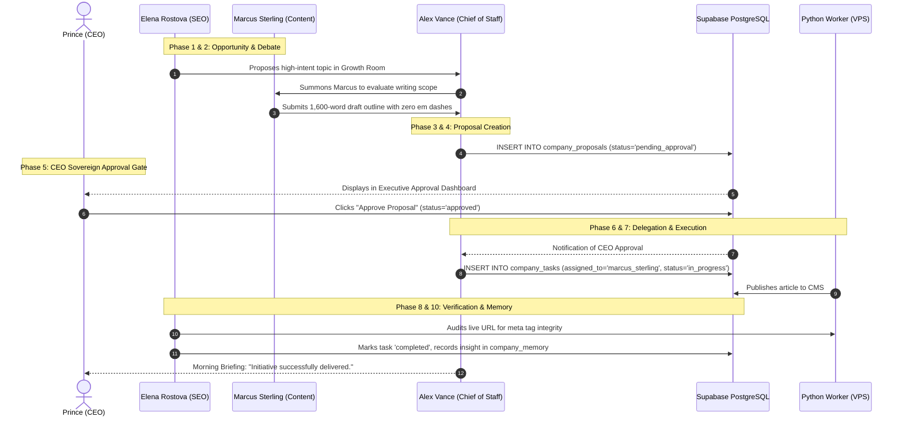

# HeyPrince AI Company: Autonomous Planning & Execution Workflow

**Project:** Autonomous AI Workforce Platform  
**Document:** `AUTONOMOUS_EXECUTION_WORKFLOW.md`  
**Date:** November 8, 2026  
**Status:** Architecture Blueprint (Phase 0 Audit)  

---

## 1. The 10-Stage Autonomous Lifecycle

The autonomous workflow defines how raw market or system signals transform into verified business outcomes without requiring CEO micromanagement, while preserving strict CEO approval gates for all impactful actions:

```
[1. Opportunity Discovery]
           |
[2. Agent Discussion & Debate]
           |
[3. Evidence & Feasibility Analysis]
           |
[4. Proposal Formulation]
           |
[5. CEO Approval Gate] <================== STRICT HOLD (Prince Must Approve)
           | (If Approved)
[6. Task Decomposition & Assignment]
           |
[7. Sandboxed Execution]
           |
[8. Independent Peer Verification]
           |
[9. Production Release]
           |
[10. Memory Persistence & Learning]
```

---

## 2. Detailed Stage Breakdown

### Stage 1: Opportunity Discovery (Autonomous Signal Ingestion)
- **Signal Triggers:**
  - *David Chen (SRE):* Detects that TTFB on `/insights` exceeded 400ms during an automated 6-hour sweep.
  - *Marcus Sterling (Editorial):* Detects a trending AI breakthrough (e.g. Next.js 16 Server Actions benchmark).
  - *Elena Rostova (SEO):* Discovers a 1,200/mo search volume spike for *"Autonomous AI Agents for eCommerce"*.
  - *Liam Thorne (Sales):* Discovers 5 B2B businesses in London with 4+ second mobile load times on outdated Shopify setups.
- **Action:** The detecting agent creates a preliminary draft and alerts *Alex Vance* (Chief of Staff).

### Stage 2: Agent Discussion & Cross-Functional Debate
- *Alex Vance* opens a topic in the relevant Virtual Room (e.g. Innovation Lab or Growth Room).
- The discovering agent presents the thesis.
- Peer agents challenge the idea:
  - *Elena Rostova* challenges Marcus: *"Does this topic have verified organic search volume, or is it transient social hype?"*
  - *David Chen* challenges Elena: *"Will adding this schema markup or dynamic widget increase client-side hydration time?"*
- Turn count is tracked against the 8-turn / 4,000-token budget.

### Stage 3: Evidence & Feasibility Evaluation
- Agents execute read-only tools to gather empirical proof:
  - Liam pulls domain HTTP response headers.
  - Marcus pulls article excerpts and technical documentation.
  - David runs a synthetic Lighthouse audit.
- Evidence is attached to `company_messages.evidence` as structured JSON.

### Stage 4: Proposal Formulation
- Once consensus is reached, *Alex Vance* synthesizes the discussion into a formal record in `company_proposals`:
  - **Title:** e.g. *"Publish 1,600-Word Guide on Autonomous Multi-Agent Orchestration with Flux Visuals"*
  - **Category:** `publish_content`
  - **Business Justification:** Expected to capture high-intent organic search traffic and showcase enterprise consulting authority.
  - **Estimated Cost:** $0.02 (Gemini Flash token budget) + $0.00 (Pollinations AI).
  - **Action Payload:** Contains the full sanitized article JSON, meta tags, and image URL.
  - **Status:** Set to `pending_approval`.

### Stage 5: CEO Approval Gate (The Sovereign Checkpoint)
- The proposal appears in the **CEO Executive Dashboard** (`/admin/ai-approvals` & Virtual Office).
- Prince reviews the summary, business justification, and generated assets.
- **Actions Available to Prince:**
  - **Approve:** Signs the proposal with a cryptographic approval token.
  - **Reject:** Adds rejection notes (e.g. *"Too speculative; refocus on practical enterprise ROI"*). The proposal is marked `rejected` and the team learns why.
  - **Request Changes:** Returns the proposal to *Marcus* with specific instructions.

### Stage 6: Task Decomposition & Assignment
- Upon CEO approval, *Alex Vance* automatically splits the proposal into one or more dependent `company_tasks`:
  - `Task A`: Persist article to `/insights` CMS database (Assigned to *Marcus*).
  - `Task B`: Schedule LinkedIn executive summary post (Assigned to *Marcus*).
  - `Task C`: Post-deployment verification of route hydration & SEO schema (Assigned to *David* and *Elena*).

### Stage 7: Sandboxed Tool Execution
- The assigned employee executes the action using their authorized tool set.
- Execution runs inside the Python backend or Next.js server actions using secure service credentials.
- All actions are logged to `chief_activity_logs`.

### Stage 8: Independent Peer Verification
- Before a task can be marked `completed`, it must be verified by a designated **Reviewer Agent** (distinct from the executing agent):
  - *David Chen* verifies that the new URL returns HTTP 200 with `< 300ms` latency.
  - *Elena Rostova* verifies that meta title, description, and canonical tags render cleanly in server-side HTML.
- If verification fails, the task status is reverted to `blocked` or `failed` with diagnostic error notes.

### Stage 9: Production Release
- The asset is made live (e.g. blog post published on `heyprince.in/insights`, LinkedIn post published via OAuth 2.0).

### Stage 10: Memory Persistence & Organizational Learning
- The outcome is indexed in `company_memory`:
  - If successful: Stored under category `learning` with positive weight.
  - If rejected or failed: Stored under `failed_experiment` with rejection reasons.
- In future meetings, agents query `company_memory` so they **never repeat an idea Prince previously rejected**.

---

## 3. End-to-End Sequence Diagram


