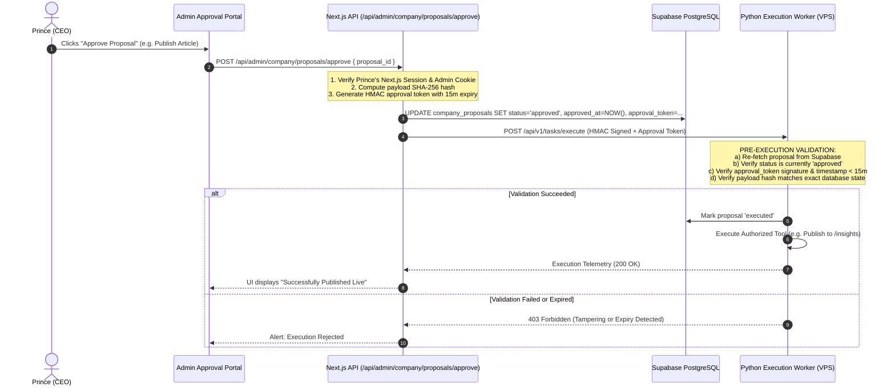

# HeyPrince AI Company: CEO Approval Engine & Security Model

**Project:** Autonomous AI Workforce Platform  
**Document:** `CEO_APPROVAL_AND_SECURITY_MODEL.md`  
**Date:** November 8, 2026  
**Status:** Architecture Blueprint (Phase 0 Audit)  

---

## 1. Security Architecture Principles

In an autonomous workforce platform, **agents must possess zero sovereign authority over external, production, or financial state**. 

The security architecture operates on four non-negotiable principles:
1. **Backend Authorization Enforcement:** CEO approval is never checked merely by hiding UI buttons. The database layer and API endpoints strictly reject unapproved task execution via cryptographic state checks.
2. **Time-Of-Check to Time-Of-Use (TOCTOU) Defense:** An approval is not an open-ended blank check. When Prince approves an action, a cryptographically signed, short-lived execution token (15-minute expiry) is issued. The executing worker validates the token, payload hash, and database status immediately before firing the tool.
3. **Role-Based Agent Isolation (Least Privilege):** An agent cannot call tools outside its registered department. *Elena Rostova* (SEO) cannot execute cold email outreach; *Marcus Sterling* (Content) cannot delete database records.
4. **Idempotent Execution:** Every approved action carries an idempotency key. Network retries or server restarts can never trigger double-posting, double-emailing, or duplicate billing.

---

## 2. Four-Tier Authority Hierarchy

```
+---------------------------------------------------------------------------------------------------+
| LEVEL 0: AUTONOMOUS READ & PLAN (Zero Human Intervention Required)                                |
| - Read-only research, crawling public RSS feeds, synthetic Lighthouse audits                      |
| - Running internal agent discussions in virtual collaboration rooms                               |
| - Creating draft proposals, internal task assignments, and activity logs                         |
| - Updating agent status pills ('thinking', 'researching', 'in_meeting')                           |
+---------------------------------------------------------------------------------------------------+
| LEVEL 1: LOW-IMPACT STAGING ACTIONS (Standard CEO Approval Required)                             |
| - Persisting blog drafts to CMS in 'draft' status (not published)                                 |
| - Generating AI cover art via Pollinations AI                                                     |
| - Updating SEO recommendations queue in admin portal                                              |
| - Creating new internal project task cards                                                        |
+---------------------------------------------------------------------------------------------------+
| LEVEL 2: EXTERNAL & PRODUCTION PUBLISHING (Explicit Cryptographic CEO Approval)                   |
| - Publishing an article to live production (heyprince.in/insights)                                |
| - Publishing a thought-leadership update to LinkedIn via OAuth 2.0                                |
| - Sending consultative cold outreach emails or WhatsApp messages to prospects                    |
| - Modifying live website meta tags, canonicals, or sitemaps                                       |
+---------------------------------------------------------------------------------------------------+
| LEVEL 3: INFRASTRUCTURE, FINANCIAL & CODE (CEO Multi-Factor Authentication Required)              |
| - Activating or hiring a new AI Employee into the company                                         |
| - Executing database DDL migrations or schema alterations                                         |
| - Upgrading or switching external paid API model tiers                                            |
| - Executing generated code in production environments                                             |
+---------------------------------------------------------------------------------------------------+
```

---

## 3. Cryptographic Approval Verification Protocol



---

## 4. Tool Sandboxing & Unrestricted Code Execution Defense

When an agent needs to execute code (e.g. calculating financial statistics or running data transformations):
- **Banned Capabilities:**
  - `os.system`, `subprocess.Popen`, raw shell commands.
  - Direct execution of `DROP`, `TRUNCATE`, or unconstrained `DELETE` SQL queries.
  - Access to filesystem directories outside `/app/data/` inside the Docker container.
  - Access to production environment variable secrets (e.g. Supabase Service Role Key is held strictly in the Next.js/Python server configuration, never passed into model prompt contexts).
- **Execution Sandboxing:**
  - Code analysis and data operations execute inside isolated, memory-capped Python sub-processes with `resource.setrlimit` enforcing 128 MB RAM and 5.0 seconds CPU time limits.
  - Network egress inside sandbox processes is disabled.

---

## 5. Audit Logging & Compliance Ledger

Every action taken by every employee is committed immutably to `chief_activity_logs`:
- **`agent_id`:** Which humanoid employee requested or executed the action.
- **`action`:** e.g. `publish_article`, `propose_meeting`, `run_guardian_sweep`.
- **`level`:** `info`, `warning`, `error`, `success`.
- **`details`:** Structured JSON containing:
  - Associated `proposal_id` or `discussion_id`.
  - IP address and user ID of the CEO who granted approval.
  - Exact payload hash, execution duration in milliseconds, and token consumption.
- **`created_at`:** ISO 8601 timestamp with millisecond precision.

This ledger ensures that Prince has a complete, tamper-evident audit trail of every autonomous activity across the enterprise.
