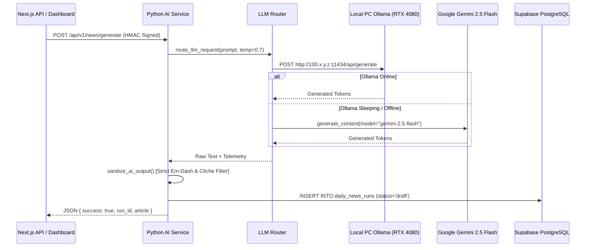

# AI & Agent Architecture

## 1. Dual-Engine LLM Router
The AI subsystem uses a priority-based failover router:

---

## 2. Autonomous Agents

| Agent Name | Primary Trigger | Implementation File | Output Destination |
| :--- | :--- | :--- | :--- |
| **Content Researcher** | Scheduled / Manual | `heyprince-ai-backend/app/agents/content_researcher.py` | `chief_content_drafts` (Service pages & blueprints) |
| **Website Guardian** | Every 6 hours | `heyprince-ai-backend/app/agents/website_guardian.py` | Site health telemetry, latency logs |
| **SEO Growth** | Every 24 hours | `heyprince-ai-backend/app/agents/seo_growth.py` | Keyword opportunities, internal linking map |
| **Lead Scout** | Manual Trigger | `heyprince-ai-backend/app/agents/lead_scout.py` | Tailored B2B website audit proposals |

---

## 3. Strict Content Sanitization Rules
Across all AI pipelines, output passes through `app/llm/sanitizer.py`:
1. **Em-Dash Ban**: Strict regex replacement converting em-dashes (`—`) to clean standard hyphens (`-`) or colons.
2. **AI Cliche Purge**: Removes robotic phrases (*"delve into"*, *"testament to"*, *"in conclusion"*, *"it is important to remember"*).
3. **Markdown Code Preservation**: Protects backtick code blocks from text sanitization mutations.
