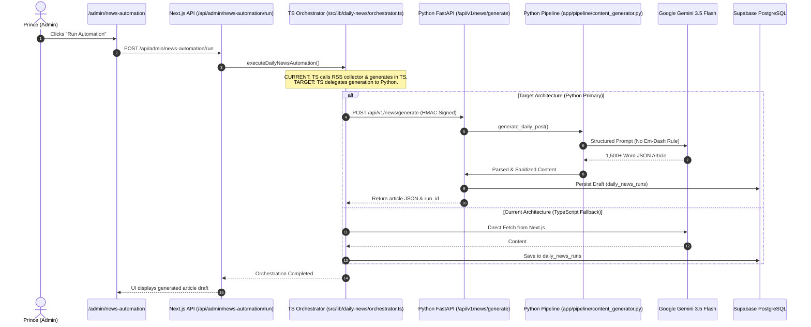

# AI Workflow Execution Map

**Audit Date:** November 8, 2026  
**Scope:** Full end-to-end tracing of all 12 AI workflows from Frontend UI through Next.js APIs to the Python AI Backend.

---

## 1. Complete Workflow Tracing Matrix

| Workflow | Frontend Trigger / UI | Next.js API Route | TypeScript Handler | Python Backend Route | Python Implementation | Current Execution State |
| :--- | :--- | :--- | :--- | :--- | :--- | :---: |
| **1. Content Generation** | Admin Posts `/admin/posts/new` or Daily News run | `/api/admin/news-automation/run` | `src/lib/daily-news/content-generator.ts` | `/api/v1/news/generate` | `app/pipeline/content_generator.py` | **TypeScript Only** (Next.js does not yet call Python) |
| **2. Daily AI News** | `/admin/news-automation` Run Button or Vercel Cron | `/api/cron/daily-news` | `src/lib/daily-news/orchestrator.ts` | `/api/v1/news/generate` | `app/pipeline/content_generator.py` | **TypeScript Only** (Next.js runs local pipeline) |
| **3. Content Researcher** | `/admin/chief-of-staff` Agent Grid -> Run Agent | `/api/admin/chief-of-staff/run-task` | `src/lib/chief-of-staff/orchestrator.ts` | `/api/v1/chief/run-agent` | `app/agents/content_researcher.py` | **Dual (Python Bridge with TS Fallback)** |
| **4. Website Guardian** | `/admin/chief-of-staff` or Vercel Cron `/api/cron/chief-of-staff` | `/api/admin/chief-of-staff/run-task` | `src/lib/chief-of-staff/orchestrator.ts` | `/api/v1/chief/run-agent` | `app/agents/website_guardian.py` | **Dual (Python Bridge with TS Fallback)** |
| **5. SEO Growth** | `/admin/chief-of-staff` or Vercel Cron `/api/cron/chief-of-staff` | `/api/admin/chief-of-staff/run-task` | `src/lib/chief-of-staff/orchestrator.ts` | `/api/v1/chief/run-agent` | `app/agents/seo_growth.py` | **Dual (Python Bridge with TS Fallback)** |
| **6. Lead Scout** | `/admin/chief-of-staff` or `/api/cron/lead-scout` | `/api/cron/lead-scout` | `src/lib/chief-of-staff/orchestrator.ts` | `/api/v1/chief/run-agent` | `app/agents/lead_scout.py` | **Dual (Python Bridge with TS Fallback)** |
| **7. Proposal Generation** | `/admin/leads` -> Generate Proposal button | `/api/admin/outreach/ai-analyze` | `src/lib/outreach/proposal-generator.ts` | `/api/v1/outreach/generate-proposal` | `app/pipeline/proposal_engine.py` | **TypeScript Only** (Next.js does not yet call Python) |
| **8. Gemini Integration** | Background LLM Calls | Direct HTTP within route handlers | `src/lib/daily-news/ai-provider.ts` | Direct REST via `httpx` | `app/llm/gemini_client.py` | **Duplicated in Both** |
| **9. Ollama Integration** | Background LLM Calls | Not implemented in TS | None (TS lacks Ollama client) | Direct HTTP via `httpx` | `app/llm/ollama_client.py` | **Python Only** |
| **10. AI Long-Term Memory** | Chief of Staff Activity Feed | `/api/admin/chief-of-staff/status` | `src/lib/chief-of-staff/db.ts` | Direct PostgreSQL via `asyncpg` | `app/llm/memory.py` | **TypeScript Dominant** (Python queries same table) |
| **11. AI Scheduling** | Automated recurrence | `vercel.json` Cron Jobs | Vercel Edge Serverless Handlers | Internal APScheduler daemon | `app/scheduler/jobs.py` | **Duplicated in Both** (Vercel Cron + APScheduler) |
| **12. AI Approvals** | `/admin/ai-approvals` & `/admin/chief-of-staff` | `/api/admin/chief-of-staff/approve-draft` | `src/lib/chief-of-staff/orchestrator.ts` | N/A (Admin business logic) | N/A (Intentionally kept in Next.js) | **TypeScript Only** (Correct Architecture) |

---

## 2. Detailed Workflow Anatomy

### Workflow 1 & 2: Daily AI News & Content Generation

### Workflow 3, 4, 5, 6: Chief of Staff Autonomous Agents
- **Front-end Entry:** Prince triggers an agent from `/admin/chief-of-staff` or the agent is triggered via scheduled cron `/api/cron/chief-of-staff`.
- **Next.js Orchestrator:** `src/lib/chief-of-staff/orchestrator.ts` checks `isAiBackendEnabled()`.
  - **If `AI_BACKEND_URL` is set:** Dispatches HMAC-SHA256 authenticated POST to `http://<vps>:8000/api/v1/chief/run-agent` with `{ agent: agentId, trigger: triggerSource, payload }`.
  - **If Python fails or is unconfigured:** Executes local TypeScript fallback (`runWebsiteGuardianAudit`, `runSeoGrowthAudit`, `runLeadScoutDiscovery`, `runContentResearcherDiscovery`).
- **Python Backend Execution:** `app/api/v1/chief.py` routes request to the specific agent in `app/agents/`.
- **Database Write:** Persists execution logs and draft proposals to `chief_activity_logs` and `chief_content_drafts`.

### Workflow 7: Lead Scout & Cold Proposal Synthesis
- **Front-end Entry:** Executive views discovered business in `/admin/leads` and clicks "Analyze & Draft Proposal".
- **Current Flow:** Calls `/api/admin/outreach/ai-analyze`, which runs `src/lib/outreach/proposal-generator.ts` in TypeScript.
- **Target Flow:** Next.js dispatches HMAC POST to `/api/v1/outreach/generate-proposal`. Python `app/pipeline/proposal_engine.py` synthesizes personalized cold emails and WhatsApp messages using LLM Router, returning structured JSON to Next.js.

### Workflow 11: AI Scheduling (Cron Conflict Analysis)
- **Currently in Next.js:** `vercel.json` defines 3 recurring schedules:
  - `30 3 * * *` -> `/api/cron/daily-news` (Daily at 03:30 UTC)
  - `0 4 * * *` -> `/api/cron/chief-of-staff` (Daily at 04:00 UTC)
  - `0 5 * * *` -> `/api/cron/lead-scout` (Daily at 05:00 UTC)
- **Currently in Python:** `app/scheduler/jobs.py` runs an independent `AsyncIOScheduler`:
  - Guardian sweep: Every 6 hours
  - SEO analysis: Every 24 hours
- **Resolution:** To prevent duplicate agent runs, the Vercel cron should remain the authoritative master scheduler for all user-facing workflows, triggering Next.js routes which then call Python via HMAC RPC. APScheduler on the VPS should handle only low-level system background sweeps (e.g. cache warmups, local memory consolidation).

### Workflow 12: Human-in-the-Loop AI Approvals
- **Status:** **Intentionally Preserved in Next.js**.
- **Reasoning:** Approval, rejection, editing, and publishing of articles to `/insights` or LinkedIn require Next.js session authentication, admin role verification, and direct CMS state mutations. The Python backend produces drafts; the human administrator approves them in Next.js.
