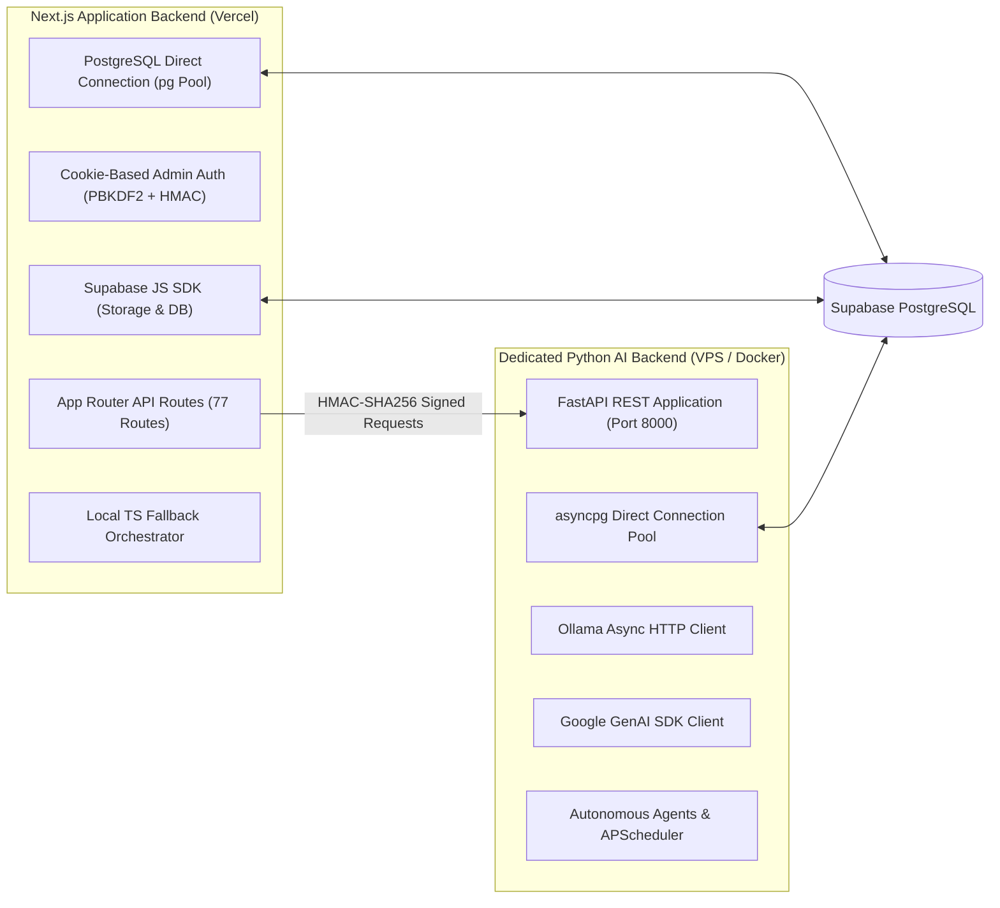

# Backend Architecture & Service Organization

## 1. Dual-Backend Architecture

### Next.js 16 Application Backend
* **Runtime**: Node.js 20+ Serverless functions running at Vercel Edge.
* **Responsibilities**:
  1. Admin authentication, session cookies, and password hashing (`src/lib/admin-db.ts`).
  2. Public API endpoints (contact inquiries, blog likes, threaded discussions, captcha challenge generation).
  3. Database CRUD operations for posts, categories, services, leads, and media records.
  4. OAuth 2.0 integration with LinkedIn for 1-click social sharing.
  5. Vercel cron job endpoints (`/api/cron/daily-news`, `/api/cron/chief-of-staff`).
  6. Delegation client (`src/lib/ai-backend-client.ts`) forwarding heavy AI workloads to Python.

### Python FastAPI Dedicated AI Backend
* **Runtime**: Python 3.11+ ASGI running inside Docker on your self-managed VPS.
* **Responsibilities**:
  1. Local Ollama inference management over private network (Tailscale / local IP).
  2. Google Gemini API integration with automatic failover routing.
  3. 1,500+ word deep SEO article synthesis and outline generation.
  4. Pollinations AI visual generation with deterministic topic seeds.
  5. Autonomous Chief of Staff agent workflows (Website Guardian, SEO Growth, Lead Scout).
  6. Background recurring jobs via APScheduler.
