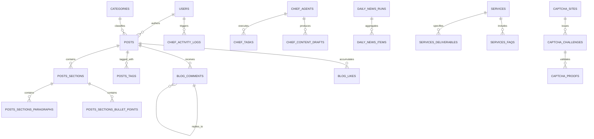

# Database Architecture & Entity Relationships

## 1. Database Overview
The platform utilizes **PostgreSQL 15+ hosted on Supabase**, connected via:
1. Supabase Client (`@supabase/supabase-js`) for public client requests and Storage bucket file management.
2. Direct PostgreSQL connection pool (`pg`) in Next.js backend for high-throughput relational queries.
3. Asynchronous PostgreSQL pool (`asyncpg`) in the Python FastAPI service.

---

## 2. Entity Relationship Diagram (ERD)

---

## 3. Verified Core Table Schemas

### `posts`
* `id` (SERIAL PRIMARY KEY)
* `title` (VARCHAR NOT NULL)
* `slug` (VARCHAR UNIQUE NOT NULL)
* `excerpt` / `description` (TEXT)
* `cover_image` (VARCHAR)
* `category_id` (INTEGER REFERENCES categories(id))
* `author_id` (INTEGER REFERENCES users(id))
* `status` (VARCHAR DEFAULT 'draft')
* `published_at` (TIMESTAMPTZ)
* `created_at` / `updated_at` (TIMESTAMPTZ)

### `chief_content_drafts`
* `id` (SERIAL PRIMARY KEY)
* `agent_id` (VARCHAR NOT NULL)
* `topic_title` (VARCHAR NOT NULL)
* `content_type` (VARCHAR)
* `status` (VARCHAR DEFAULT 'pending_approval')
* `raw_outline` (JSONB)
* `seo_metadata` (JSONB)
* `created_at` / `updated_at` (TIMESTAMPTZ)

### `daily_news_runs`
* `id` (SERIAL PRIMARY KEY)
* `topic_title` (VARCHAR NOT NULL)
* `category` (VARCHAR)
* `raw_content` (JSONB NOT NULL)
* `status` (VARCHAR DEFAULT 'draft')
* `cover_image` (VARCHAR)
* `trigger_type` (VARCHAR)
* `created_at` / `updated_at` (TIMESTAMPTZ)

### `client_leads`
* `id` (SERIAL PRIMARY KEY)
* `name` (VARCHAR NOT NULL)
* `email` (VARCHAR NOT NULL)
* `phone` (VARCHAR)
* `service` (VARCHAR)
* `budget` (VARCHAR)
* `timeline` (VARCHAR)
* `message` (TEXT)
* `status` (VARCHAR DEFAULT 'new')
* `created_at` (TIMESTAMPTZ)

### `blog_comments`
* `id` (SERIAL PRIMARY KEY)
* `post_slug` (VARCHAR NOT NULL)
* `author_name` (VARCHAR NOT NULL)
* `author_email` (VARCHAR)
* `content` (TEXT NOT NULL)
* `parent_id` (INTEGER REFERENCES blog_comments(id))
* `is_verified_admin` (BOOLEAN DEFAULT false)
* `likes_count` (INTEGER DEFAULT 0)
* `created_at` (TIMESTAMPTZ)
