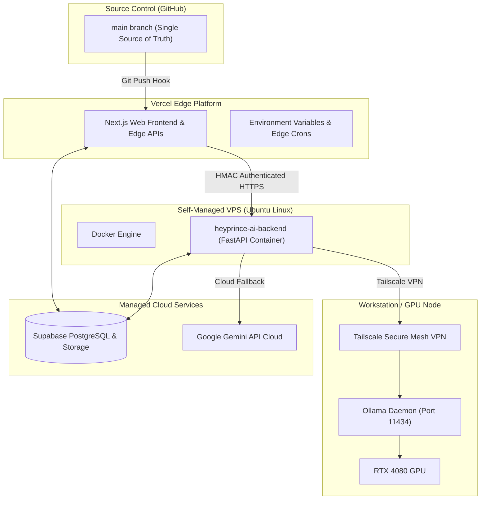

# Deployment & Infrastructure Topology

## 1. Multi-Tier Hybrid Infrastructure

---

## 2. Deployment Workflows
1. **Frontend & Application Tier (Vercel)**:
   * Commits pushed to `main` automatically trigger Vercel preview/production builds (`next build`).
   * Edge cron triggers fire `/api/cron/*` on schedule.
2. **Dedicated AI Backend (VPS)**:
   * Containerized via `Dockerfile` and `docker-compose.yml`.
   * Bootstrapped with `docker compose up -d --build`.
   * Exposes port `8000` mapped to internal Uvicorn server.
