# Final AI Backend Consolidation & Migration Plan

**Audit Date:** November 8, 2026  
**Objective:** A phased, risk-free plan to make `heyprince-ai-backend/` the single authoritative execution engine for all AI workloads, preserving existing Next.js frontend, authentication, and database integrity.

---

## 1. Architectural Principles

1. **Decoupled Heavy Compute:** Heavy LLM generation, deep scraping, and agent loops execute exclusively in Python on the VPS. Next.js functions remain fast, lightweight HTTP bridges.
2. **Zero Breaking Changes to UI:** Admin UI components (`/admin/chief-of-staff`, `/admin/news-automation`, `/admin/leads`, `/admin/ai-approvals`) continue calling their existing Next.js API routes (`/api/admin/*`).
3. **Cryptographic Inter-Service Security:** Next.js and Python communicate over HMAC-SHA256 authenticated REST RPC. No API keys, service roles, or internal secrets are exposed to client browsers.
4. **Resilient Local Fallback:** TypeScript AI routines are preserved as fallback handlers. If the VPS is down or undergoing maintenance, Next.js falls back to local routines with zero customer downtime.
5. **No Duplicate Execution:** Schedulers and background triggers are unified under a single authoritative orchestrator.

---

## 2. Phased Execution Roadmap

```mermaid
flowchart TD
    subgraph Phase1["Phase 1: Code Harmonization & Verification (Local)"]
        P1A["Fix Python Internal Import Discrepancies"]
        P1B["Resolve Pydantic DEBUG String Parsing"]
        P1C["Update Gemini Candidate Models to gemini-3.5-flash"]
        P1D["Run Full Local Test Suite (100% Pass)"]
    end

    subgraph Phase2["Phase 2: VPS Container Deployment"]
        P2A["Upload heyprince-ai-backend to VPS"]
        P2B["Configure Production .env with Supabase URI & Secret"]
        P2C["Deploy via Docker Compose (Port 8000)"]
        P2D["Verify Live Health Check (/api/v1/health)"]
    end

    subgraph Phase3["Phase 3: Next.js API Route Wiring"]
        P3A["Set AI_BACKEND_URL & AI_SERVICE_SECRET in Vercel"]
        P3B["Wire Daily News Orchestrator to /api/v1/news/generate"]
        P3C["Wire Outreach Proposals to /api/v1/outreach/generate-proposal"]
        P3D["Verify Chief of Staff Bridge to /api/v1/chief/run-agent"]
    end

    subgraph Phase4["Phase 4: Hardware & Ollama Host Decision"]
        P4A["Confirm Inference Host (Intel Laptop vs Separate GPU vs Gemini)"]
        P4B["Establish Private Tailscale Mesh if Local Host Selected"]
        P4C["Configure Model Parameters"]
    end

    subgraph Phase5["Phase 5: End-to-End Verification"]
        P5A["Trigger Manual Article Run from /admin/news-automation"]
        P5B["Trigger Guardian & Scout Audits from /admin/chief-of-staff"]
        P5C["Verify Draft Persistence in Supabase"]
        P5D["Confirm Zero Duplicate Logs or Double Approvals"]
    end

    Phase1 --> Phase2
    Phase2 --> Phase3
    Phase3 --> Phase4
    Phase4 --> Phase5
```



---

## 3. Step-by-Step Implementation Details

### Phase 1: Code Harmonization (Ready for Immediate Approval)
- **Target Files:**
  - `heyprince-ai-backend/app/core/config.py`: Add Pydantic field validator for `DEBUG`, define `HOST`, `LOG_LEVEL`, `ENABLE_AUTONOMOUS_CRON`, `OLLAMA_HOST`, `GEMINI_FALLBACK_MODEL`, `CORS_ORIGINS`.
  - `heyprince-ai-backend/app/core/database.py`: Expose `db_pool`, `init_db_pool()`, `close_db_pool()`.
  - `heyprince-ai-backend/app/llm/gemini_client.py`: Set candidate models to `["gemini-3.5-flash", "gemini-3.8-flash", "gemini-3.1-flash-lite"]`.
  - `heyprince-ai-backend/app/llm/router.py`: Add alias function `route_llm_request()`.
  - `heyprince-ai-backend/app/llm/sanitizer.py`: Add alias function `sanitize_ai_output()`.
  - `heyprince-ai-backend/app/pipeline/content_generator.py`: Add alias `generate_deep_seo_article = generate_daily_post`.
  - `heyprince-ai-backend/app/pipeline/proposal_engine.py`: Add alias `generate_tailored_proposal = generate_lead_proposal`.
  - `heyprince-ai-backend/app/llm/ollama_client.py`: Add alias `check_ollama_health = ollama_client.is_available`.
  - `heyprince-ai-backend/app/agents/seo_growth.py` & `lead_scout.py`: Clean up imports.

### Phase 2: VPS Deployment
- Run on your VPS:
  ```bash
  git clone https://github.com/princeg2302/heyprince.git
  cd heyprince/heyprince-ai-backend
  cp .env.example .env
  # Add your secret, Supabase URI, and Gemini API key
  docker compose up -d --build
  ```
- Test from VPS terminal:
  ```bash
  curl -s http://localhost:8000/api/v1/health | jq
  ```

### Phase 3: Next.js API Route Integration
1. In Vercel Environment Variables:
   - `AI_BACKEND_URL`: `https://your-vps-domain-or-ip:8000` (or behind HTTPS proxy)
   - `AI_SERVICE_SECRET`: `<32_char_shared_secret>`
2. Connect `src/lib/daily-news/orchestrator.ts`:
   - Delegate content synthesis to Python `/api/v1/news/generate`.
3. Connect `src/app/api/admin/outreach/ai-analyze/route.ts`:
   - Delegate proposal synthesis to Python `/api/v1/outreach/generate-proposal`.

### Phase 4: Resolution of Hardware & Model Host
- Confirm model strategy based on findings in `HARDWARE_AND_OLLAMA_VERIFICATION.md`.
- Disable duplicate cron in Python (`ENABLE_SCHEDULER=false`) to prevent double-execution while Vercel Cron is active.

### Phase 5: Production Acceptance Criteria
- [ ] `/api/v1/health` returns `status: "online"`, `database.connected: true`.
- [ ] Running a post from `/admin/news-automation` completes in ~5s via Python backend.
- [ ] Human approval workflow in `/admin/ai-approvals` receives clean, sanitized, 1,500+ word drafts without em dashes.
- [ ] Chief of Staff tasks log accurately with zero duplicate runs.
- [ ] Stopping the VPS container causes Next.js to cleanly fall back to local TypeScript routines without throwing user-facing 500 errors.

---

## 4. Immediate Approval Request

Per your instruction:
> *"Do not modify application code, delete TypeScript AI logic, change production settings or deploy anything during this audit. Wait for my approval after presenting the findings."*

The complete inspection, live unit testing, hardware audit, and workflow mapping are finished. All 6 deliverables have been generated. We are ready to execute **Phase 1 (Code Harmonization)** upon your approval.
