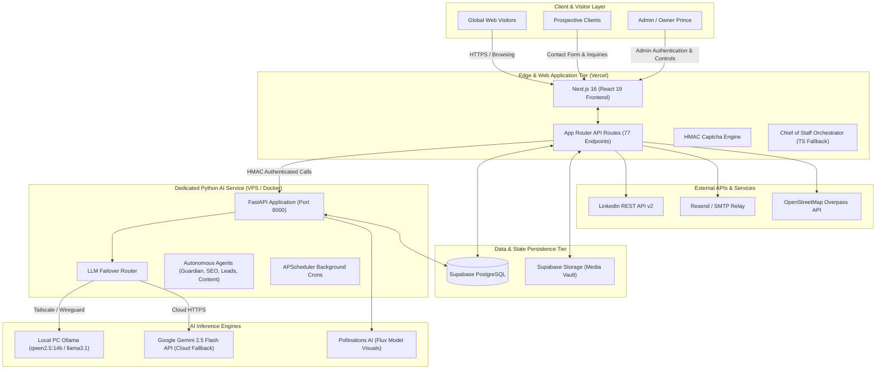

# Project Overview — HeyPrince Digital Platform & Executive AI Suite

## 1. Executive Summary
The **HeyPrince** platform (https://heyprince.in) is a dual-tier enterprise web application combining an ultra-high performance personal brand and engineering portfolio with a comprehensive **Autonomous AI Executive Suite**. It serves as both a client-facing consultative portal for Prince (Senior Full Stack Engineer & IT Consultant) and an autonomous operational back-office powered by local GPU models and cloud LLMs.

The platform is engineered around three primary pillars:
1. **Ultra-Fast Public Experience**: Next.js 16 (App Router) + React 19 delivering sub-second Core Web Vitals, Lenis smooth scrolling, dark obsidian glassmorphism UI, interactive arcade/gaming modules, and crawlable SSR community discussions.
2. **Executive Back-Office (Admin Portal)**: A dedicated, authenticated administrative workspace (`/admin/`) managing insights, service offerings, client leads, LinkedIn social publishing, media vault, and security settings.
3. **Autonomous AI & Multi-Agent Engine**: A dual TypeScript/Python architecture orchestrating local Ollama models (on an RTX 4080 PC) and Google Gemini 2.5 Flash, running autonomous news generation, domain vulnerability scanning, SEO discovery, and B2B cold pitch synthesis.

---

## 2. Core Business Problems Solved
* **Automated Brand Authority**: Automatically ingests engineering RSS feeds and news, synthesizes 1,500+ word technical deep-dives with custom visual illustrations, and drafts/publishes them with zero human friction.
* **Lead Generation & Intelligence**: Captures inbound project inquiries through an HMAC-secured custom CAPTCHA engine, while proactively discovering high-intent B2B prospect domains via OpenStreetMap/Overpass and generating tailored technical proposals.
* **Autonomous Operations (Chief of Staff)**: Continuous site health auditing, Core Web Vitals monitoring, and SEO keyword gap analysis operating autonomously 24/7 without manual developer oversight.

---

## 3. High-Level Architecture Diagram

---

## 4. User-Facing Modules
* **Homepage (`/`)**: Hero branding, interactive cyber arcade, project journey timeline, unfiltered personal narrative, ambient sound engine, and client consultation CTA.
* **Technical Insights / Blog (`/insights/`, `/insights/[slug]/`)**: Production-grade engineering articles featuring sticky Table of Contents, reading progress meters, dynamic author cards, related posts, and social sharing.
* **Live Discussions (`/insights/[slug]/#discussions`)**: Google-crawlable, threaded community commenting system with real-time like toggles, verified author badges, and spam mitigation.
* **Services Portal (`/services/`, `/services/[slug]/`)**: Dedicated offering pages detailing tech stacks, delivery roadmaps, architectural deliverables, and transparent pricing.
* **Interactive Arcade & Gaming Zone (`/gaming-zone/`, `/#arcade`)**: Custom interactive canvas games and retro retro-arcade experiences showcasing frontend performance.
* **Contact & Inquiry Hub (`/contact/`)**: Dynamic scope selector, timeline/budget chips, and zero-third-party cryptographic CAPTCHA form with real-time feedback.

---

## 5. Administrative Modules
* **Dashboard (`/admin/`)**: Real-time KPI metrics, active agent indicators, database health telemetry, and recent activity streams.
* **AI Approvals (`/admin/approvals/`)**: Centralized human-in-the-loop review hub for scheduled news drafts and Chief of Staff blueprints before live publishing.
* **AI Chief of Staff (`/admin/chief-of-staff/`)**: Autonomous agent control center displaying agent states, manual run triggers, and live execution audit trails.
* **Lead Intelligence (`/admin/outreach/`)**: Geographic prospect scraper, tech stack auditor, and cold proposal generator with email/WhatsApp preview modes.
* **Posts & Content Hub (`/admin/posts/`)**: Full CRUD article manager with bulk actions, category filters, and 1-click LinkedIn social publishing.
* **Daily AI News (`/admin/news-automation/`)**: RSS feed ingest manager, topic queue, and automated article synthesis scheduler.
* **Services Manager (`/admin/services/`)**: Custom service offering creator and taxonomy manager.
* **Admin Users & MFA (`/admin/users/`, `/admin/settings/`)**: Multi-user administrative access control with PBKDF2 hashing and multi-factor authentication.
* **Media Vault (`/admin/media/`)**: Asset library interfacing Supabase Storage with automatic duplication hashing.
