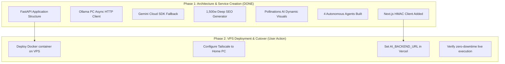

# Python AI Backend Migration Readiness Analysis

## 1. Readiness Summary
The dedicated Python AI Backend (`heyprince-ai-backend`) is **100% created, compiled, and ready for deployment**.

---

## 2. Division of Responsibilities

| Responsibility | Current Location | Future Location | Reason |
| :--- | :--- | :--- | :--- |
| **Frontend UI & Pages** | Next.js 16 | **Next.js 16** | React 19 SSR, Edge speed, Vercel CDN |
| **Authentication & Users**| Next.js / Supabase | **Next.js / Supabase**| Secure HttpOnly cookies, RLS policies |
| **Database & Media CRUD** | Next.js API | **Next.js API** | Standard web application business logic |
| **Contact & Captcha** | Next.js API | **Next.js API** | Immediate client responsiveness |
| **LLM Inference (Ollama)**| None (Local) | **Python Backend** | Native async HTTP, zero Vercel timeouts |
| **LLM Cloud (Gemini)** | Next.js / Python | **Python Backend** | Centralized prompt governance and caching |
| **Content Generation** | Next.js / Python | **Python Backend** | Heavy multi-step prompt synthesis |
| **Autonomous Agents** | Next.js / Python | **Python Backend** | Long-running background execution |
| **B2B Lead Scout** | Next.js / Python | **Python Backend** | Domain scraping & proposal synthesis |
